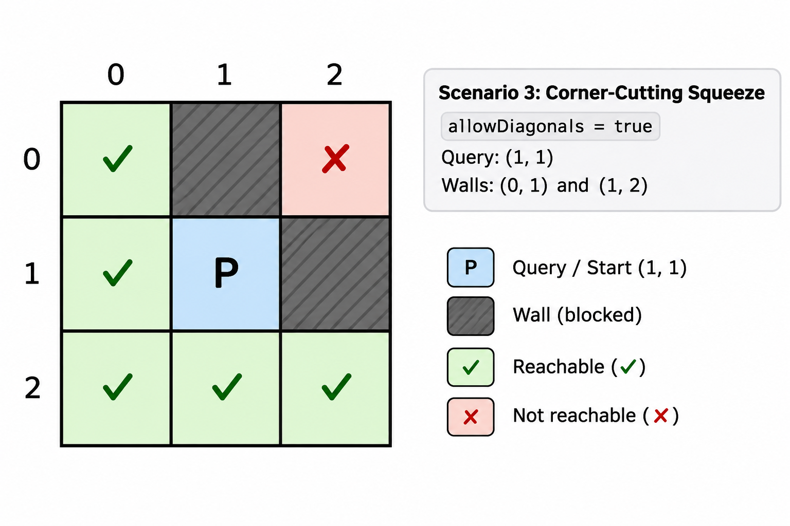

# Stage 1: Grid & Basic Traversal — Practice Tasks & Learning Contracts

Exported chat log (Gemini + ChatGPT). Contracts and scenarios only—no implementation solutions.


## Reference

> **You asked**
>
> give me taks for each , no of tasks per row is not a strict number rather choosen to solidify understanding , dont give solution only problem statement/task

### Prerequisites & core foundations (v0.1)

| Concept / Skill | Role | Explanation | Quick Resource |
| :--- | :--- | :--- | :--- |
| **2D Arrays & Coordinate Math** | Prerequisite | Representing grid states (empty, wall, start, end) and calculating orthogonal/diagonal neighbor offsets (`dx`, `dy`) while enforcing boundary checks. | [MDN: 2D Array Guide](https://developer.mozilla.org/en-US/docs/Web/JavaScript/Reference/Global_Objects/Array) |
| **Basic Data Structures (Queues, Sets, Maps)** | Prerequisite | Using FIFO queues for traversal order, `Set` for tracking visited nodes ($O(1)$ lookups), and `Map` (parent pointers) to reconstruct the final path backward from target to start. | [MDN: Set, Map, Queue Patterns](https://developer.mozilla.org/en-US/docs/Web/JavaScript/Reference/Global_Objects/Set) |
| **Graph Theory Basics** | Learn / Use | Modeling a 2D grid as an implicit unweighted graph where cells are vertices and adjacent traversable cells are edges. | [Wikipedia: Graph Theory](https://en.wikipedia.org/wiki/Graph_theory) |
| **Breadth-First Search (BFS)** | Learn / Use | Exploring the grid in concentric waves to guarantee the shortest path in unweighted grids. | [Wikipedia: BFS](https://en.wikipedia.org/wiki/Breadth-first_search) |
| **React State & Grid Rendering** | Prerequisite | Managing grid state updates cleanly in TypeScript/React and mapping 2D array states to DOM elements, SVG, or an HTML5 `<canvas>`. | [React Docs: State Management](https://react.dev/learn/state-a-components-memory) |

### Practice tasks & milestones

| Concept / Skill | Concrete Tasks (Problem Statements) |
| :--- | :--- |
| **2D Arrays & Coordinate Math** | 1. **Grid Initializer & Serializer:** Write a function `createGrid(rows, cols)` returning a typed 2D grid of cell objects (`{ row, col, type }`), plus a helper `printGrid(grid)` that outputs an ASCII representation (`.` for empty, `#` for wall, `S` for start, `E` for end).<br>2. **Safe Neighbor Lookup:** Implement `getNeighbors(grid, row, col, allowDiagonals)` that returns valid, in-bounds neighbor coordinates while filtering out `"wall"` cells.<br>3. **Corner-Cutting Prevention:** Extend `getNeighbors` when `allowDiagonals = true` so a diagonal move is rejected if *both* adjacent orthogonal cells are walls (preventing squeezing through diagonal gaps). |
| **Basic Data Structures (Queues, Sets, Maps)** | 1. **Coordinate Key Hashing:** Write `toKey(row, col)` and `fromKey(key)` helpers to serialize `(row, col)` coordinates into primitive strings so JavaScript `Set` and `Map` perform value-based $O(1)$ lookups instead of reference-based lookups.<br>2. **Parent-Pointer Path Reconstructor:** Given a populated `cameFrom: Map<string, string>` and a `targetKey`, write `reconstructPath(cameFrom, startKey, targetKey)` that walks backward from target to start and returns the ordered coordinate array from start to target (or `[]` if unreachable). |
| **Graph Theory Basics** | 1. **Connected Components Counter:** Given a 2D grid containing random walls, count how many isolated "islands" of walkable cells exist.<br>2. **Reachability & Dead-End Detector:** Write a function that takes a start coordinate and returns whether the target is reachable at all, plus the total count of walkable cells trapped behind closed wall loops. |
| **Breadth-First Search (BFS)** | 1. **Wavefront Distance Map:** Run BFS from `(0, 0)` on an open 10×10 grid and populate each cell with its exact step distance from the start; print the resulting distance matrix to verify concentric expansion.<br>2. **Shortest Path Solver (v0.1 Core):** Implement `bfs(grid, start, end)` returning `{ visitedOrder: Coord[], shortestPath: Coord[] }`. Test it against three edge cases: an open grid, a winding U-shaped trap, and a completely walled-off target. |
| **React State & Grid Rendering** | 1. **Static Grid Visualizer:** Render a 20×20 state-backed grid in React where cell background colors dynamically reflect cell states (`empty`, `wall`, `start`, `end`, `visited`, `path`).<br>2. **Interactive Wall Toggle & Reset:** Add click handlers to toggle cells between `empty` and `wall` (protecting `start` and `end` from being overwritten), plus a "Clear Walls" and "Reset Path" button that immutably updates React state.<br>3. **Instant Path Overlay:** Wire a "Run BFS" button that executes your solver on the current grid state and highlights the returned `shortestPath` cells on screen. |


## 1. 2D Arrays & Coordinate Math

### 1.1 Grid Initializer & Serializer

> **You asked** — `2026-11-19 18:43:38`
>
> 1. Grid Initializer & Serializer: Write a function createGrid(rows, cols) returning a typed 2D grid of cell objects ({ row, col, type }), plus a helper printGrid(grid) that outputs an ASCII representation (. for empty, # for wall, S for start, E for end).
>
> for this give input/usage scenerio for createGrid(rows, cols) 
> dont give answer , i just want to understand what i need to build
>


#### Response (Gemini)

#### Usage Scenarios & Expected Contracts

##### 1. Basic Initialization (`createGrid`)
* **Input:** `createGrid(3, 4)`
* **Expected Behavior:**
  * Returns a 2D array with **3 outer arrays (rows)**, each containing **4 cell objects (columns)**.
  * Every cell defaults to `type: "empty"` (or `CellType.Empty`) and stores its own coordinates (`row: 0..2`, `col: 0..3`).
  * **Memory isolation check:** Modifying `grid[0][0].type = "wall"` must **not** mutate `grid[1][0]` (a common bug when initializing 2D arrays with `Array.fill()`).

---

##### 2. State Mutation & ASCII Serialization (`printGrid`)
* **Input Sequence:**
  ```ts
  const grid = createGrid(4, 5);
  grid[0][0].type = "start";
  grid[3][4].type = "end";
  grid[1][1].type = "wall";
  grid[1][2].type = "wall";
  grid[2][2].type = "wall";

  console.log(printGrid(grid));
  ```
* **Expected Console Output:**
  ```text
  S . . . .
  . # # . .
  . . # . .
  . . . . E
  ```

---

##### 3. Edge Cases to Handle
| Scenario | Input | Expected Behavior |
| :--- | :--- | :--- |
| **Non-square dimensions** | `createGrid(2, 6)` | Row index accesses `grid[row][col]` cleanly without swapping `rows` and `cols` (`grid.length === 2`, `grid[0].length === 6`). |
| **Zero / invalid dimensions** | `createGrid(0, 5)` or `createGrid(-1, 3)` | Either returns `[]` cleanly or throws a descriptive error—never enters an infinite loop. |
| **Single-cell grid** | `createGrid(1, 1)` | Returns `[[{ row: 0, col: 0, type: "empty" }]]` and prints `"."`. |


---


#### 1.2 Next task contract: Task 2 & 3 (`getNeighbors`)

* **Signature:**
  ```ts
  interface Coord {
    row: number;
    col: number;
  }

  function getNeighbors(
    grid: GridCell[][],
    row: number,
    col: number,
    allowDiagonals = false
  ): Coord[]
  ```
* **Expected Behavior:**
  1. **Bounds & Walls:** Returns adjacent coordinates that are within `[0, rows - 1]` and `[0, cols - 1]` and where `type !== "wall"`. (Start/end cells **are** walkable).
  2. **4-Way (`allowDiagonals = false`):** Checks Up, Down, Left, Right.
  3. **8-Way (`allowDiagonals = true`):** Also checks the 4 diagonals, **except** a diagonal step `(row + dr, col + dc)` is blocked if **both** adjacent orthogonal cells `(row + dr, col)` and `(row, col + dc)` are walls (or out of bounds).

* **Verification Scenarios:**

| Scenario | Setup | Expected Output |
| :--- | :--- | :--- |
| **Top-left corner** | `(0, 0)` on an open 3×3 grid (`allowDiagonals = false`) | `[{ row: 1, col: 0 }, { row: 0, col: 1 }]` (order doesn't matter) |
| **Orthogonal wall block** | `(1, 1)` surrounded by walls at `(0, 1)` and `(1, 0)` (`allowDiagonals = false`) | `[{ row: 2, col: 1 }, { row: 1, col: 2 }]` |
| **Corner-cutting squeeze** | `(1, 1)` with walls at `(0, 1)` and `(1, 2)`, open at `(0, 2)` (`allowDiagonals = true`) | `(0, 2)` is **excluded** because both orthogonal neighbors between `(1, 1)` and `(0, 2)` are walls |
| **Single wall corner pass** | `(1, 1)` with a wall ONLY at `(0, 1)`, open at `(1, 2)` and `(0, 2)` (`allowDiagonals = true`) | `(0, 2)` is **included** (only one orthogonal neighbor is blocked) |


---


---

### 1.2 Safe Neighbor Lookup & Corner-Cutting — ASCII verification

> **You asked** — `2026-11-19 20:22:13`
>
> for above task 
> Expected Behavior:
> Verification Scenarios:
>
> give asci visualiztion 
>
> dont give solution/code
>


#### Response (Gemini)


#### Legend
* `P` = Target cell `(row, col)` being queried
* `✓` = Valid neighbor (returned)
* `✗` = Blocked diagonal (excluded due to corner-cutting)
* `#` = Wall
* `.` = Empty (unvisited / out of reach)

---

#### Scenario 1: Top-Left Corner (`allowDiagonals = false`)
**Query:** `(0, 0)` on an open 3×3 grid

```text
  0 1 2
0 P ✓ .
1 ✓ . .
2 . . .
```
* **Returned:** `(0, 1)`, `(1, 0)`
* **Rejected:** Up `(-1, 0)` and Left `(0, -1)` are out of bounds (`< 0`).

---

#### Scenario 2: Orthogonal Wall Block (`allowDiagonals = false`)
**Query:** `(1, 1)` with walls at `(0, 1)` and `(1, 0)`

```text
  0 1 2
0 . # .
1 # P ✓
2 . ✓ .
```
* **Returned:** `(1, 2)`, `(2, 1)`
* **Rejected:** `(0, 1)` and `(1, 0)` have `type === "wall"`.

---

#### Scenario 3: Corner-Cutting Squeeze (`allowDiagonals = true`)

**Query:** `(1, 1)` with walls at `(0, 1)` and `(1, 2)`

```text
  0 1 2
0 ✓ # ✗
1 ✓ P #
2 ✓ ✓ ✓
```
* **Returned:** `(0, 0)`, `(1, 0)`, `(2, 0)`, `(2, 1)`, `(2, 2)`
* **Why `(0, 2)` is `✗`:** Both orthogonal neighbors bridging `(1, 1)` to `(0, 2)`—specifically `(0, 1)` above and `(1, 2)` right—are walls. Squeezing between them is blocked.

---

#### Scenario 4: Single Wall Corner Pass (`allowDiagonals = true`)
**Query:** `(1, 1)` with a wall **only** at `(0, 1)`

```text
  0 1 2
0 ✓ # ✓
1 ✓ P ✓
2 ✓ ✓ ✓
```
* **Returned:** All 7 non-wall surrounding cells, including `(0, 2)`.
* **Why `(0, 2)` is `✓`:** Even though `(0, 1)` is a wall, `(1, 2)` is open—so you can step around the corner without clipping through two adjacent walls.


---


## 2. Basic Data Structures (Queues, Sets, Maps)

> **You asked** — `2026-11-20 15:42:20`
>
> now for this
> Concept / Skill	 | Concrete Tasks (Problem Statements)
> Basic Data Structures (Queues, Sets, Maps)	1. Coordinate Key Hashing: Write toKey(row, col) and fromKey(key) helpers to serialize (row, col) coordinates into primitive strings so JavaScript Set and Map perform value-based  O(1) lookups instead of reference-based lookups.
> 2. Parent-Pointer Path Reconstructor: Given a populated cameFrom: Map<string, string> and a targetKey, write reconstructPath(cameFrom, startKey, targetKey) that walks backward from target to start and returns the ordered coordinate array from start to target (or [] if unreachable).
>


**Response (ChatGPT)**

### 2.1 Coordinate Key Hashing

#### Usage Scenarios & Expected Contracts

##### 1. Basic / minimal usage

**Input\:**

```ts
const key = toKey(3, 5);
const coordinate = fromKey(key);
```

**Expected output\:**

```ts
key = "3,5"

coordinate = {
  row: 3,
  col: 5
}
```

**Expected behavior\:**

- Convert a row and column pair into a primitive string.
- The same coordinate must always produce the same key.
- Different coordinates must produce different keys.
- `fromKey` must recover the original row and column values.
- Coordinates are compared by value, not object reference.
- Serialization must be unambiguous for all supported coordinates.

##### 2. Stateful or composed usage

**Input sequence\:**

```ts
const visited = new Set<string>();
const distances = new Map<string, number>();

const key1 = toKey(2, 3);
const key2 = toKey(2, 3);

visited.add(key1);
distances.set(key1, 10);

const isVisited = visited.has(key2);
const distance = distances.get(key2);
```

**Expected output\:**

```ts
{
  isVisited: true,
  distance: 10,
  setSize: 1,
  mapSize: 1
}
```

The same coordinate must resolve to the same Set and Map entry, even when serialized through separate calls.

##### 3. Edge cases

| Scenario | Input | Expected behavior |
|--------|--------|--------|
| Origin coordinate | `(0, 0)` | `"0,0"` |
| Positive coordinates | `(3, 5)` | `"3,5"` |
| Same row | `(2, 1)`, `(2, 5)` | Different keys |
| Same column | `(1, 3)`, `(5, 3)` | Different keys |
| Swapped coordinates | `(2, 3)`, `(3, 2)` | Different keys |
| Single-digit coordinates | `(1, 2)` | `"1,2"` |
| Multi-digit coordinates | `(12, 34)` | `"12,34"` |
| Negative coordinates | `(-1, 3)` | Reject with `RangeError` |
| Fractional coordinates | `(1.5, 2)` | Reject with `RangeError` |
| Non-finite coordinates | `(NaN, 2)` | Reject with `RangeError` |
| Malformed key | `"abc"` | Reject with `RangeError` |
| Missing coordinate | `fromKey("")` | Reject with `RangeError` |

---

#### API contract

**Signature\:**

```ts
type Coordinate = {
  row: number;
  col: number;
};

function toKey(row: number, col: number): string;

function fromKey(key: string): Coordinate;
```

**Expected behavior\:**

1. Both coordinates must be non-negative integers.
2. Coordinates must be within JavaScript's safe integer range.
3. `toKey` must return a deterministic string in the format `"row,col"`\.
4. The comma is the only separator.
5. `fromKey` must return an object containing exactly `row` and `col`\.
6. `fromKey(toKey(row, col))` must recover the original coordinate.
7. Different valid coordinate pairs must never produce the same key.
8. Invalid input must throw `RangeError`\.
9. No global state or external data structures are required.
10. Both operations must have constant-time complexity, O(1), assuming bounded-size coordinate representations.

**Verification scenarios\:**

| Scenario | Setup | Expected output |
|--------|--------|--------|
| Round-trip | `fromKey(toKey(4, 7))` | `{ row: 4, col: 7 }` |
| Uniqueness | `toKey(2,3)` vs `toKey(3,2)` | Different strings |
| Determinism | Call `toKey(4,7)` twice | Identical strings |
| Set lookup | Insert key, generate same key again | `true` |
| Map lookup | Insert key, generate same key again | Original value |
| Negative input | `toKey(-1, 2)` | Throw `RangeError` |
| Malformed serialization | `fromKey("2,x")` | Throw `RangeError` |

#### Verification detail

**Legend**

| Symbol | Meaning |
|--------|--------|
| `R,C` | Row and column |
| `KEY` | Serialized coordinate |

**Scenario 1: Coordinate round-trip**

Input\:

```text
Coordinate: (3, 5)
      |
      v
toKey(3, 5)
      |
      v
    "3,5"
      |
      v
fromKey("3,5")
      |
      v
Coordinate: (3, 5)
```

Expected\:

```ts
{
  row: 3,
  col: 5
}
```

**Scenario 2: Value-based Set lookup**

Input\:

```ts
const visited = new Set<string>();

visited.add(toKey(1, 2));

visited.has(toKey(1, 2));
visited.has(toKey(2, 1));
```

Expected\:

| Lookup | Result |
|--------|--------|
| `(1, 2)` | `true` |
| `(2, 1)` | `false` |

Why: Different coordinate pairs must have different serialized keys.

---

### 2.2 Parent-Pointer Path Reconstructor

#### Usage Scenarios & Expected Contracts

##### 1. Basic / minimal usage

**Input\:**

```ts
const cameFrom = new Map<string, string>([
  ["1,0", "0,0"],
  ["1,1", "1,0"],
  ["2,1", "1,1"],
  ["2,2", "2,1"],
]);

const path = reconstructPath(
  cameFrom,
  "0,0",
  "2,2"
);
```

**Expected output\:**

```ts
[
  { row: 0, col: 0 },
  { row: 1, col: 0 },
  { row: 1, col: 1 },
  { row: 2, col: 1 },
  { row: 2, col: 2 }
]
```

**Expected behavior\:**

- Reconstruct the path by following parent references backward from the target.
- Return coordinates in forward order: start to target.
- Include both start and target in the returned path.
- Return an empty array when the target cannot be connected to the start through the parent map.
- Do not modify `cameFrom`\.
- Do not include unrelated entries from the map.

##### 2. Stateful or composed usage

**Input sequence\:**

```ts
const cameFrom = new Map<string, string>();

cameFrom.set("1,0", "0,0");
cameFrom.set("1,1", "1,0");
cameFrom.set("2,1", "1,1");

const firstPath = reconstructPath(
  cameFrom,
  "0,0",
  "2,1"
);

cameFrom.set("2,2", "2,1");

const secondPath = reconstructPath(
  cameFrom,
  "0,0",
  "2,2"
);

const unreachablePath = reconstructPath(
  cameFrom,
  "0,0",
  "5,5"
);
```

**Expected output\:**

```ts
firstPath = [
  { row: 0, col: 0 },
  { row: 1, col: 0 },
  { row: 1, col: 1 },
  { row: 2, col: 1 }
];

secondPath = [
  { row: 0, col: 0 },
  { row: 1, col: 0 },
  { row: 1, col: 1 },
  { row: 2, col: 1 },
  { row: 2, col: 2 }
];

unreachablePath = [];
```

Each invocation must use the current contents of `cameFrom`\. Previously returned paths must not change when the map is modified.

##### 3. Edge cases

| Scenario | Input | Expected behavior |
|--------|--------|--------|
| Start equals target | `startKey = "0,0"`, `targetKey = "0,0"` | Return `[{ row: 0, col: 0 }]` |
| Direct parent | Target directly references start | Return two coordinates |
| Multi-step path | Several parent references | Return complete ordered path |
| Empty map | Target differs from start | Return `[]` |
| Target absent | No entry for target | Return `[]` |
| Missing intermediate parent | Chain breaks before start | Return `[]` |
| Unrelated map entries | Map contains another path | Ignore unrelated entries |
| Multiple branches | Several nodes share a parent | Follow only target's parent chain |
| Cyclic parent references | Parent chain loops | Throw `RangeError` |
| Invalid target key | Malformed coordinate string | Throw `RangeError` |
| Invalid parent key | Malformed key in traversed chain | Throw `RangeError` |
| Invalid start key | Malformed coordinate string | Throw `RangeError` |

---

#### API contract

**Signature\:**

```ts
type Coordinate = {
  row: number;
  col: number;
};

function reconstructPath(
  cameFrom: Map<string, string>,
  startKey: string,
  targetKey: string
): Coordinate[];
```

**Expected behavior\:**

1. `cameFrom` maps a child coordinate key to its parent coordinate key.
2. `startKey` identifies the beginning of the path.
3. `targetKey` identifies the destination.
4. The returned path must be ordered from start to target.
5. Both start and target must be included.
6. If `startKey === targetKey`, return a single-element path containing start.
7. If the target is absent from `cameFrom`, return `[]`\.
8. If any intermediate parent is missing before reaching start, return `[]`\.
9. Parent traversal must terminate only when `startKey` is reached or a failure is detected.
10. Cyclic parent references must throw `RangeError`\.
11. Invalid coordinate keys in the traversed chain must throw `RangeError`\.
12. Unrelated map entries must not affect the result.
13. The original Map must remain unchanged.
14. Returned coordinates must be newly created objects, not references to Map entries.
15. The returned array must not contain duplicate coordinates due to cycles.

**Complexity contract\:**

Let `L` be the number of nodes in the reconstructed path.

| Operation | Expected complexity |
|--------|--------|
| Parent lookup | O(1) average |
| Full reconstruction | O(L) average |
| Returned path storage | O(L) |

**Verification scenarios\:**

| Scenario | Setup | Expected output |
|--------|--------|--------|
| Valid chain | `A ← B ← C` | `[A, B, C]` |
| Direct connection | `A ← B` | `[A, B]` |
| Same start and target | `A === A` | `[A]` |
| Missing target | Target not in Map | `[]` |
| Broken chain | Intermediate parent missing | `[]` |
| Branching | Two children share a parent | Only requested branch |
| Cycle | `A ← B ← C ← B` | Throw `RangeError` |
| Invalid parent | Traversed parent has malformed key | Throw `RangeError` |

#### Verification detail

**Legend**

| Symbol | Meaning |
|--------|--------|
| `S` | Start |
| `T` | Target |
| `P` | Parent pointer |
| `#` | Wall |
| `.` | Walkable cell |
| `→` | Direction of reconstructed path |
| `X` | Unreachable or broken chain |

**Scenario 1: Valid parent chain**

Setup: Target has a complete parent chain leading to start.

```text
     0   1   2
   +---+---+---+
0  | S | . | # |
   +---+---+---+
1  | # | . | # |
   +---+---+---+
2  | # | . | T |
   +---+---+---+
```

Parent relationships\:

```text
"0,1" -> "0,0"
"1,1" -> "0,1"
"2,1" -> "1,1"
"2,2" -> "2,1"
```

Expected returned path\:

```ts
[
  { row: 0, col: 0 },
  { row: 0, col: 1 },
  { row: 1, col: 1 },
  { row: 2, col: 1 },
  { row: 2, col: 2 }
]
```

Why: Parent references are stored backward, but the returned path must be forward.

**Scenario 2: Broken parent chain**

Setup: An intermediate parent is missing.

```text
     0   1   2   3
   +---+---+---+---+
0  | S | . | X | T |
   +---+---+---+---+
```

Parent relationships\:

```text
"1,0" -> "0,0"
"2,0" -> "1,0"
"3,0" -> "2,0"
```

Expected\:

```ts
[]
```

Why: The chain cannot establish a complete connection to `startKey`\.

**Scenario 3: Multiple branches**

Setup: Two paths share a parent but lead to different targets.

```text
       A
      / \
     B   C
     |   |
     D   E
```

Parent relationships\:

```text
B -> A
C -> A
D -> B
E -> C
```

Expected for target `D`\:

```text
[A, B, D]
```

Expected for target `E`\:

```text
[A, C, E]
```

Why: Reconstruction must follow only the target's ancestry, not every entry in the Map.

**Scenario 4: Cyclic parent references**

Setup\:

```text
A -> B
B -> C
C -> B
```

Expected\:

```text
Throw RangeError
```

Why: The parent chain never reaches the start and must not cause an infinite traversal.

---

#### Shared contract between both tasks

| Aspect | Coordinate Key Hashing | Parent-Pointer Reconstructor |
|--------|--------|--------|
| Primary data structure | String | Map |
| Uses coordinate keys | Yes | Yes |
| Depends on `toKey` | — | Yes, conceptually |
| Depends on `fromKey` | — | Yes |
| Mutates input | No | No |
| Return type | String / Coordinate | Coordinate array |
| Main responsibility | Coordinate identity | Path ordering |
| Average complexity | O(1) | O(L) |

#####*Important design boundary\:** `reconstructPath` should treat `cameFrom` as an already-populated data structure. It should not perform pathfinding, validate grid connectivity, or determine whether a path is optimal. Its responsibility is strictly parent-chain validation and path reconstruction.

---


## 3. Graph Theory Basics

> **You asked** — `2026-11-20 15:40:32`
>
> Sent the [task contract prompt](#appendix-task-contract-prompt) (see **Appendix**) with context:
>
> - **Project / domain:** pathfinding visualizer  
> - **Stack / language:** ts  
> - **Concept / skill:** Graph Theory Basics — Connected Components Counter; Reachability & Dead-End Detector


**Response (ChatGPT)**

### 3.1 Connected Components Counter

#### Usage Scenarios & Expected Contracts

##### 1. Basic / minimal usage

**Input\:**

```ts
const grid = [
  [0, 1, 0],
  [0, 1, 0],
  [1, 0, 0],
];

const count = countConnectedComponents(grid);
```

**Expected behavior\:**

- Return the total number of isolated groups of walkable cells.
- Two cells belong to the same component if they are connected through cardinal directions (up, down, left, right).
- Diagonal connections do not count.
- Walls are never included in a component.
- Every walkable cell must belong to exactly one component.
- Do not mutate the input grid.

**Expected output\:**

```ts
2
```

##### 2. Stateful or composed usage

**Input sequence\:**

```ts
const grid = [
  [0, 1, 0],
  [0, 1, 0],
  [1, 0, 0],
];

const initial = countConnectedComponents(grid);

grid[1][1] = 0;

const afterOpeningWall = countConnectedComponents(grid);
```

**Expected output\:**

```text
initial: 2
afterOpeningWall: 1
```

Each invocation evaluates the current grid independently. Previous results must not affect subsequent invocations.

##### 3. Edge cases

| Scenario | Input | Expected behavior |
|--------|--------|--------|
| Empty grid | `[]` | Return `0` |
| All walls | `[[1,1],[1,1]]` | Return `0` |
| Single walkable cell | `[[0]]` | Return `1` |
| All walkable cells | `[[0,0],[0,0]]` | Return `1` |
| Completely isolated cells | `[[0,1,0]]` | Return `2` |
| Diagonal-only connections | `[[0,1],[1,0]]` | Return `2` |
| Single row | `[[0,0,1,0]]` | Return `2` |
| Single column | `[[0],[1],[0]]` | Return `2` |
| Multiple independent regions | `[[0,1,0],[1,1,1],[0,1,0]]` | Return `4` |

---

#### API contract

**Signature\:**

```ts
type Cell = 0 | 1;
type Grid = Cell[][];

function countConnectedComponents(grid: Grid): number;
```

**Expected behavior\:**

1. `0` represents a walkable cell.
2. `1` represents a wall.
3. Connectivity uses four cardinal directions.
4. Every connected group contributes exactly one to the result.
5. Diagonal adjacency does not establish connectivity.
6. Input must be rectangular. Invalid grid structure throws `RangeError`\.
7. Empty grids return `0`\.
8. Input must remain unchanged.
9. Return type is always a non-negative integer.

**Verification scenarios\:**

| Scenario | Setup | Expected output |
|--------|--------|--------|
| Independent regions | Three separated walkable regions | `3` |
| Connected region | All walkable cells connected | `1` |
| Diagonal adjacency | Two diagonally adjacent cells | `2` |
| No walkable cells | All walls | `0` |
| Empty input | Empty grid | `0` |
| Invalid grid | Rows have different lengths | Throw `RangeError` |

#### Verification detail

**Legend**

| Symbol | Meaning |
|--------|--------|
| `.` | Walkable cell |
| `#` | Wall |
| `A`, `B`, `C` | Different connected components |

**Scenario 1: Multiple connected components**

Setup: Three independent groups of walkable cells.

```text
     0   1   2   3   4
   +---+---+---+---+---+
0  | A | A | # | B | B |
   +---+---+---+---+---+
1  | # | # | # | # | # |
   +---+---+---+---+---+
2  | C | # | # | # | . |
   +---+---+---+---+---+
```

Expected\:

```text
componentCount = 3
components = [A, B, C]
```

The isolated `.` at `(2,4)` should actually be counted as its own component.

(Correction) The exact expected count for this diagram is **4**\.

**Scenario 2: Diagonal-only connectivity**

Setup: Two walkable cells touch only diagonally.

```text
     0   1
   +---+---+
0  | A | # |
   +---+---+
1  | # | B |
   +---+---+
```

Expected\:

```text
componentCount = 2
```

Why: Diagonal adjacency does not establish connectivity.

**Scenario 3: Fully connected region**

Setup: All cells are walkable.

```text
     0   1   2
   +---+---+---+
0  | A | A | A |
   +---+---+---+
1  | A | A | A |
   +---+---+---+
2  | A | A | A |
   +---+---+---+
```

Expected\:

```text
componentCount = 1
```

---

### 3.2 Reachability & Dead-End Detector

#### Usage Scenarios & Expected Contracts

##### 1. Basic / minimal usage

**Input\:**

```ts
const grid = [
  [0, 0, 1, 0],
  [1, 0, 1, 0],
  [0, 0, 1, 0],
  [0, 1, 1, 0],
];

const result = analyzeReachability(
  grid,
  { row: 0, col: 0 },
  { row: 3, col: 3 }
);
```

**Expected behavior\:**

- Determine whether the target is reachable from the start.
- Return whether a valid path exists.
- Count all walkable cells that cannot be reached from the start.
- A cell is considered trapped if it is not reachable from the start using cardinal movement.
- Walls are excluded from the trapped-cell count.
- Do not mutate the input grid.

**Expected output\:**

```ts
{
  isReachable: true,
  trappedCellCount: 1
}
```

##### 2. Stateful or composed usage

**Input sequence\:**

```ts
const grid = [
  [0, 0, 1],
  [1, 0, 1],
  [0, 0, 0],
];

const start = { row: 0, col: 0 };
const target = { row: 2, col: 2 };

const first = analyzeReachability(grid, start, target);

// Open the wall separating the left region.
grid[1][0] = 0;

const second = analyzeReachability(grid, start, target);
```

**Expected output\:**

```ts
first = {
  isReachable: true,
  trappedCellCount: 0
};

second = {
  isReachable: true,
  trappedCellCount: 0
};
```

Opening this particular wall does not change reachability because the existing walkable path already connects the regions.

##### 3. Edge cases

| Scenario | Input | Expected behavior |
|--------|--------|--------|
| Start equals target | Same start and target coordinate | Reachable |
| Target surrounded by walls | No valid path to target | `isReachable: false` |
| Start surrounded by walls | Start is isolated | Only start is reachable |
| All cells walkable | Fully open grid | Trapped count `0` |
| All cells except start are walls | Single walkable cell | Reachable only if target is start |
| Multiple disconnected regions | Several isolated walkable groups | Count all walkable cells outside start's region |
| Target in disconnected region | Valid target, no connecting path | `isReachable: false` |
| Target is a wall | Target coordinate contains wall | Throw `RangeError` |
| Start is a wall | Start coordinate contains wall | Throw `RangeError` |
| Out-of-bounds start | Invalid start coordinate | Throw `RangeError` |
| Out-of-bounds target | Invalid target coordinate | Throw `RangeError` |
| Empty grid | `[]` | Throw `RangeError` |

---

#### API contract

**Signature\:**

```ts
type Coordinate = {
  row: number;
  col: number;
};

type ReachabilityResult = {
  isReachable: boolean;
  trappedCellCount: number;
};

function analyzeReachability(
  grid: Grid,
  start: Coordinate,
  target: Coordinate
): ReachabilityResult;
```

**Expected behavior\:**

1. `0` represents walkable cells; `1` represents walls.
2. Movement is restricted to four cardinal directions.
3. The start coordinate must be a valid walkable cell.
4. The target coordinate must be a valid walkable cell.
5. `isReachable` indicates whether a path exists between start and target.
6. `trappedCellCount` counts all walkable cells unreachable from the start.
7. Trapped-cell counting is independent of target reachability.
8. A disconnected component containing the target contributes all its walkable cells to the trapped count.
9. The start cell is always considered reachable from itself.
10. The input grid must not be modified.
11. Invalid grid dimensions or coordinates throw `RangeError`\.
12. The result must always contain both properties.

**Important semantic distinction\:**

For this contract, *trapped cells* means all walkable cells outside the start's connected component. It does not require proving that a region is geometrically enclosed by walls.

**Verification scenarios\:**

| Scenario | Setup | Expected output |
|--------|--------|--------|
| Target reachable | Start and target in same component | `true`, trapped `0` |
| Target unreachable | Target in another component | `false`, trapped = cells in other components |
| Multiple disconnected regions | Three components, start in first | Trapped = size of second + third |
| Start equals target | Same valid coordinate | `true` |
| Isolated start | Start has no walkable neighbors | Trapped = total walkable cells - 1 |
| Invalid start | Start on wall | Throw `RangeError` |
| Invalid target | Target outside grid | Throw `RangeError` |

#### Verification detail

**Legend**

| Symbol | Meaning |
|--------|--------|
| `#` | Wall |
| `S` | Start |
| `T` | Target |
| `.` | Reachable walkable cell |
| `X` | Unreachable walkable cell |

**Scenario 1: Target reachable**

Setup: Start and target belong to the same connected region.

```text
       0   1   2   3   4
     +---+---+---+---+---+
  0  | S | . | # | X | X |
     +---+---+---+---+---+
  1  | # | . | # | X | # |
     +---+---+---+---+---+
  2  | . | . | . | . | T |
     +---+---+---+---+---+
```

Expected\:

```ts
{
  isReachable: true,
  trappedCellCount: 4
}
```

Why: The target is reachable. The four `X` cells belong to a disconnected region.

**Scenario 2: Target unreachable**

Setup: A wall barrier separates start and target.

```text
       0   1   2   3   4
     +---+---+---+---+---+
  0  | S | . | # | T | X |
     +---+---+---+---+---+
  1  | . | . | # | X | X |
     +---+---+---+---+---+
  2  | . | # | # | X | X |
     +---+---+---+---+---+
```

Expected\:

```ts
{
  isReachable: false,
  trappedCellCount: 6
}
```

Why: The target and five other walkable cells are disconnected from the start.

(Correction) The diagram contains **6 trapped cells**, including `T`\.

**Scenario 3: Multiple disconnected regions**

Setup: Three separate walkable components.

```text
       0   1   2   3   4
     +---+---+---+---+---+
  0  | S | . | # | X | # |
     +---+---+---+---+---+
  1  | # | # | # | # | # |
     +---+---+---+---+---+
  2  | X | # | # | T | X |
     +---+---+---+---+---+
```

Expected\:

```ts
{
  isReachable: false,
  trappedCellCount: 4
}
```

Why: The start component has two cells. The other two components contain one and three cells respectively.

---

#### Important distinction between the two tasks

| Aspect | Connected Components Counter | Reachability & Dead-End Detector |
|--------|--------|--------|
| Starting coordinate | Not required | Required |
| Target coordinate | Not required | Required |
| Counts all components | Yes | No |
| Checks target reachability | No | Yes |
| Counts unreachable cells | No | Yes |
| Input grid mutation | Not allowed | Not allowed |
| Connectivity | Four directions | Four directions |

**Shared contract\:** Both tasks operate on the same grid representation and use the same movement/connectivity rules. This allows their results to be compared directly in your pathfinding visualizer.

---


## 4. Breadth-First Search (BFS)

> **You asked** — `2026-11-20 15:43:33`
>
> now for this
> Concept / Skill	 | Concrete Tasks (Problem Statements)
> Breadth-First Search (BFS)	1. Wavefront Distance Map: Run BFS from (0, 0) on an open 10×10 grid and populate each cell with its exact step distance from the start; print the resulting distance matrix to verify concentric expansion.
> 2. Shortest Path Solver (v0.1 Core): Implement bfs(grid, start, end) returning { visitedOrder: Coord[], shortestPath: Coord[] }. Test it against three edge cases: an open grid, a winding U-shaped trap, and a completely walled-off target.
>


**Response (ChatGPT)**

### 4.1 Wavefront Distance Map

#### Usage Scenarios & Expected Contracts

##### 1. Basic / minimal usage

**Input\:**

Run BFS from `(0, 0)` on an open 10×10 grid.

```ts
const grid = Array.from(
  { length: 10 },
  () => Array(10).fill(0)
);

const distances = buildDistanceMap(
  grid,
  { row: 0, col: 0 }
);
```

**Expected behavior\:**

- Calculate the minimum number of cardinal moves required to reach every walkable cell from the start.
- The starting cell has distance `0`\.
- Each adjacent walkable cell has distance `1`\.
- Every subsequent cell has a distance exactly one greater than its predecessor along a shortest path.
- Unreachable cells must have distance `-1`\.
- Walls must have distance `-1`\.
- The input grid must remain unchanged.
- Distance values must represent shortest-path distances, not traversal order.

**Expected output\:**

```text
 0  1  2  3  4  5  6  7  8  9
 1  2  3  4  5  6  7  8  9 10
 2  3  4  5  6  7  8  9 10 11
 3  4  5  6  7  8  9 10 11 12
 4  5  6  7  8  9 10 11 12 13
 5  6  7  8  9 10 11 12 13 14
 6  7  8  9 10 11 12 13 14 15
 7  8  9 10 11 12 13 14 15 16
 8  9 10 11 12 13 14 15 16 17
 9 10 11 12 13 14 15 16 17 18
```

##### 2. Stateful or composed usage

**Input sequence\:**

```ts
const grid = [
  [0, 0, 0],
  [0, 1, 0],
  [0, 0, 0],
];

const first = buildDistanceMap(grid, { row: 0, col: 0 });

// Open the blocked cell.
grid[1][1] = 0;

const second = buildDistanceMap(grid, { row: 0, col: 0 });
```

**Expected output\:**

First distance map\:

```text
 0  1  2
 1  #  3
 2  3  4
```

Second distance map\:

```text
 0  1  2
 1  2  3
 2  3  4
```

Each invocation must calculate distances using the current grid state.

##### 3. Edge cases

| Scenario | Input | Expected behavior |
|--------|--------|--------|
| Single cell | `[[0]]` | `[[0]]` |
| Start at origin | Open 2×2 grid | `[[0,1],[1,2]]` |
| All walls | `[[1,1],[1,1]]` | Throw `RangeError` for invalid start |
| Wall surrounding start | `[[0,1],[1,1]]` | Start distance `0`; remaining cells `-1` |
| Disconnected region | `[[0,1,0]]` | `[[0,-1,-1]]` |
| Obstacles in path | `[[0,1,0],[0,0,0]]` | `[[0,-1,4],[1,2,3]]` |
| Single row | `[[0,0,0,0]]` | `[[0,1,2,3]]` |
| Single column | `[[0],[0],[0]]` | `[[0],[1],[2]]` |
| Empty grid | `[]` | Throw `RangeError` |
| Invalid start | Out-of-bounds coordinate | Throw `RangeError` |

---

#### API contract

**Signature\:**

```ts
type Cell = 0 | 1;

type Grid = Cell[][];

type Coord = {
  row: number;
  col: number;
};

type DistanceMap = number[][];

function buildDistanceMap(
  grid: Grid,
  start: Coord
): DistanceMap;
```

**Expected behavior\:**

1. `0` represents a walkable cell.
2. `1` represents a wall.
3. Movement is restricted to four cardinal directions.
4. Distance represents the minimum number of moves from start.
5. The starting cell always has distance `0`\.
6. Every reachable walkable cell must have a non-negative integer distance.
7. Walls and unreachable walkable cells must have distance `-1`\.
8. The output dimensions must match the input grid.
9. The input grid must not be modified.
10. Invalid grid dimensions or an invalid/non-walkable start must throw `RangeError`\.
11. Return a new distance matrix on every invocation.
12. The distance map must not depend on any previous invocation.

**Verification scenarios\:**

| Scenario | Setup | Expected output |
|--------|--------|--------|
| Open 2×2 | Start `(0,0)` | `[[0,1],[1,2]]` |
| Open 3×3 | Start `(0,0)` | `[[0,1,2],[1,2,3],[2,3,4]]` |
| Wall obstruction | Middle cell blocked | Distances reflect alternate shortest route |
| Disconnected region | Separate walkable island | `-1` for island |
| Invalid start | Start outside grid | Throw `RangeError` |

#### Verification detail

**Legend**

| Symbol | Meaning |
|--------|--------|
| `S` | Start |
| `#` | Wall |
| `-1` | Unreachable |
| Number | Minimum distance from start |

**Scenario 1: Open 5×5 grid**

Setup: No obstacles; start at `(0,0)`\.

```text
     0   1   2   3   4
   +---+---+---+---+---+
0  | 0 | 1 | 2 | 3 | 4 |
   +---+---+---+---+---+
1  | 1 | 2 | 3 | 4 | 5 |
   +---+---+---+---+---+
2  | 2 | 3 | 4 | 5 | 6 |
   +---+---+---+---+---+
3  | 3 | 4 | 5 | 6 | 7 |
   +---+---+---+---+---+
4  | 4 | 5 | 6 | 7 | 8 |
   +---+---+---+---+---+
```

Expected\:

```text
Maximum distance = 8
Reachable cells = 25
Unreachable cells = 0
```

Why: Distance increases by one for every horizontal or vertical move.

**Scenario 2: Obstacle forces a detour**

Setup: Middle cell is blocked.

```text
     0   1   2
   +---+---+---+
0  | 0 | 1 | 2 |
   +---+---+---+
1  | 1 | # | 3 |
   +---+---+---+
2  | 2 | 3 | 4 |
   +---+---+---+
```

Expected\:

```text
distances = [
  [0, 1, 2],
  [1, -1, 3],
  [2, 3, 4]
]
```

Why: The shortest route to `(2,2)` requires four moves around the obstacle.

**Scenario 3: Disconnected region**

Setup: A wall separates two walkable regions.

```text
     0   1   2   3   4
   +---+---+---+---+---+
0  | 0 | 1 | -1| -1| -1|
   +---+---+---+---+---+
1  | 1 | 1 | -1| -1| -1|
   +---+---+---+---+---+
2  | 1 | 1 | -1| -1| -1|
   +---+---+---+---+---+
```

Expected\:

```text
reachableCells = 1
unreachableWalkableCells = 9
```

Why: BFS cannot reach the cells on the other side of the wall.

---

### 4.2 Shortest Path Solver (v0.1 Core)

#### Usage Scenarios & Expected Contracts

##### 1. Basic / minimal usage

**Input\:**

```ts
const grid = [
  [0, 0, 0],
  [0, 1, 0],
  [0, 0, 0],
];

const result = bfs(
  grid,
  { row: 0, col: 0 },
  { row: 2, col: 2 }
);
```

**Expected behavior\:**

- Find the shortest path from start to end.
- Return the order in which cells were first discovered.
- Return the shortest path in start-to-end order.
- Include start and end in `shortestPath` when reachable.
- Include each discovered cell exactly once in `visitedOrder`\.
- Do not include walls in either returned array.
- If the target is unreachable, return an empty `shortestPath`\.
- The input grid must remain unchanged.

**Expected output\:**

```ts
{
  visitedOrder: [
    { row: 0, col: 0 },
    { row: 1, col: 0 },
    { row: 0, col: 1 },
    { row: 2, col: 0 },
    { row: 0, col: 2 },
    { row: 2, col: 1 },
    { row: 1, col: 2 },
    { row: 2, col: 2 }
  ],

  shortestPath: [
    { row: 0, col: 0 },
    { row: 1, col: 0 },
    { row: 2, col: 0 },
    { row: 2, col: 1 },
    { row: 2, col: 2 }
  ]
}
```

**Ordering contract\:** Use the neighbor priority `DOWN → RIGHT → UP → LEFT`\. This makes `visitedOrder` and tie-breaking in `shortestPath` deterministic.

##### 2. Stateful or composed usage

**Input sequence\:**

```ts
const grid = [
  [0, 0, 0],
  [0, 1, 0],
  [0, 0, 0],
];

const first = bfs(
  grid,
  { row: 0, col: 0 },
  { row: 2, col: 2 }
);

// Change the grid.
grid[1][1] = 0;

const second = bfs(
  grid,
  { row: 0, col: 0 },
  { row: 2, col: 2 }
);

// Search in the opposite direction.
const third = bfs(
  grid,
  { row: 2, col: 2 },
  { row: 0, col: 0 }
);
```

**Expected output\:**

| Invocation | Shortest path length (cells) | Expected behavior |
|--------|--------|--------|
| First | 5 | Finds a route around the wall |
| Second | 5 | Finds a shortest route through the opened cell |
| Third | 5 | Finds a shortest route in reverse direction |

The opened cell does not reduce the Manhattan shortest distance in this particular grid.

Each invocation must be independent. No visited state or parent relationships from earlier searches may leak into subsequent searches.

##### 3. Edge cases

| Scenario | Input | Expected behavior |
|--------|--------|--------|
| Start equals end | Same valid coordinate | Path contains only start |
| Direct horizontal path | `[[0,0,0]]` | Three-cell path |
| Direct vertical path | `[[0],[0],[0]]` | Three-cell path |
| Open grid | No walls | Manhattan shortest distance |
| Multiple shortest paths | Symmetric open grid | Deterministic path based on neighbor priority |
| Winding U-shaped trap | Only one valid route around U-shaped walls | Return complete shortest route |
| Target surrounded by walls | No possible route | Empty `shortestPath` |
| Start surrounded by walls | Isolated start, different target | Empty `shortestPath` |
| Target is a wall | End coordinate contains wall | Throw `RangeError` |
| Start is a wall | Start coordinate contains wall | Throw `RangeError` |
| Out-of-bounds coordinate | Invalid start or end | Throw `RangeError` |
| Empty grid | `[]` | Throw `RangeError` |
| No walkable path | Disconnected regions | Empty `shortestPath` |

---

#### API contract

**Signature\:**

```ts
type Coord = {
  row: number;
  col: number;
};

type BFSResult = {
  visitedOrder: Coord[];
  shortestPath: Coord[];
};

function bfs(
  grid: Grid,
  start: Coord,
  end: Coord
): BFSResult;
```

**Expected behavior\:**

1. `0` represents a walkable cell.
2. `1` represents a wall.
3. Movement is restricted to four cardinal directions.
4. The start and end must be valid walkable coordinates.
5. `visitedOrder` contains cells in first-discovery order.
6. Each coordinate appears at most once in `visitedOrder`\.
7. The start must be the first element of `visitedOrder`\.
8. Walls must never appear in `visitedOrder`\.
9. `shortestPath` must contain the minimum-move route from start to end.
10. Both start and end must be included in a successful path.
11. If start equals end, `shortestPath` contains one coordinate.
12. If the target is unreachable, `shortestPath` must be `[]`\.
13. If the target is unreachable, `visitedOrder` must still contain all cells reachable from start.
14. Neighbor exploration order must be `DOWN → RIGHT → UP → LEFT`\.
15. When multiple shortest paths exist, the returned path must follow the deterministic neighbor ordering.
16. The input grid must remain unchanged.
17. Invalid grid dimensions or invalid/non-walkable start/end coordinates throw `RangeError`\.
18. Each invocation must return new arrays and coordinate objects.

**Complexity contract\:**

Let `V` represent the number of walkable cells and `E` the number of valid cardinal connections.

| Operation | Expected complexity |
|--------|--------|
| BFS traversal | O(V + E) |
| Path reconstruction | O(V) worst case |
| Total time | O(V + E) |
| Auxiliary space | O(V) |

**Verification scenarios\:**

| Scenario | Setup | Expected output |
|--------|--------|--------|
| Direct path | Three horizontal cells | Path length `3` |
| Open grid | 3×3, opposite corners | Path length `5` |
| Wall detour | Center blocked | Path length `5` |
| Multiple shortest paths | Open 2×2 | Deterministic path |
| U-shaped trap | One winding route | Complete valid shortest route |
| Unreachable target | Separate components | `shortestPath: []` |
| Same start/end | Identical coordinates | Single-cell path |
| Invalid start/end | Wall or out of bounds | Throw `RangeError` |

#### Verification detail

**Legend**

| Symbol | Meaning |
|--------|--------|
| `S` | Start |
| `T` | Target |
| `#` | Wall |
| `.` | Walkable cell |
| `1, 2, 3...` | Discovery order |
| `→` | Shortest path direction |

**Scenario 1: Open grid**

Setup: 3×3 open grid, start `(0,0)`, target `(2,2)`\.

```text
       0   1   2
     +---+---+---+
0    | S | 3 | 6 |
     +---+---+---+
1    | 2 | 5 | 7 |
     +---+---+---+
2    | 4 | 8 | T |
     +---+---+---+
```

Expected `visitedOrder`\:

```ts
[
  { row: 0, col: 0 },
  { row: 1, col: 0 },
  { row: 0, col: 1 },
  { row: 2, col: 0 },
  { row: 1, col: 1 },
  { row: 0, col: 2 },
  { row: 2, col: 1 },
  { row: 1, col: 2 },
  { row: 2, col: 2 }
]
```

Expected `shortestPath`\:

```ts
[
  { row: 0, col: 0 },
  { row: 1, col: 0 },
  { row: 2, col: 0 },
  { row: 2, col: 1 },
  { row: 2, col: 2 }
]
```

Note: Discovery labels above represent discovery order, not distance. The target is discovered last.

**Scenario 2: Winding U-shaped trap**

Setup: Start must travel around a U-shaped wall formation to reach the target.

```text
       0   1   2   3   4   5
     +---+---+---+---+---+---+
0    | S | . | . | . | . | . |
     +---+---+---+---+---+---+
1    | . | # | # | # | # | . |
     +---+---+---+---+---+---+
2    | . | # | # | # | # | . |
     +---+---+---+---+---+---+
3    | . | # | # | # | # | . |
     +---+---+---+---+---+---+
4    | . | . | . | . | . | T |
     +---+---+---+---+---+---+
```

Expected shortest path\:

```ts
[
  { row: 0, col: 0 },
  { row: 1, col: 0 },
  { row: 2, col: 0 },
  { row: 3, col: 0 },
  { row: 4, col: 0 },
  { row: 4, col: 1 },
  { row: 4, col: 2 },
  { row: 4, col: 3 },
  { row: 4, col: 4 },
  { row: 4, col: 5 }
]
```

Expected\:

```text
shortestPath.length = 10
shortestDistance = 9
```

Why: BFS must find the shortest valid route around the wall formation rather than attempting to cross walls.

**Scenario 3: Completely walled-off target**

Setup: Target is separated from the start.

```text
       0   1   2   3   4
     +---+---+---+---+---+
0    | S | . | # | T | # |
     +---+---+---+---+---+
1    | . | . | # | # | # |
     +---+---+---+---+---+
2    | . | . | # | # | # |
     +---+---+---+---+---+
```

Expected\:

```ts
{
  visitedOrder: [
    { row: 0, col: 0 },
    { row: 1, col: 0 },
    { row: 0, col: 1 },
    { row: 2, col: 0 },
    { row: 1, col: 1 },
    { row: 2, col: 1 }
  ],
  shortestPath: []
}
```

Why: The target is not reachable. BFS must finish discovering the entire start-connected region and return no path.

---

#### Shared contract between both tasks

| Aspect | Wavefront Distance Map | Shortest Path Solver |
|--------|--------|--------|
| Starting coordinate | Required | Required |
| Target coordinate | Not required | Required |
| BFS traversal | Yes | Yes |
| Computes distances | Yes | Implicitly |
| Tracks discovery order | Not required | Yes |
| Reconstructs path | No | Yes |
| Handles unreachable cells | `-1` | Empty path |
| Input mutation | Not allowed | Not allowed |
| Complexity | O(V + E) | O(V + E) |

#####*Important design boundary\:** Both tasks use the same BFS traversal rules, but have different output responsibilities.

- `buildDistanceMap` answers: How far is every reachable cell from the start?
- `bfs` answers: In what order were cells discovered, and what is the shortest route to the target?

For your visualizer, `visitedOrder` can drive the exploration animation, while `shortestPath` can drive the final path-highlight animation.

---


## 5. React State & Grid Rendering

> **You asked** — `2026-11-20 15:44:32`
>
> now for this
> Concept / Skill	 | Concrete Tasks (Problem Statements)
> React State & Grid Rendering	1. Static Grid Visualizer: Render a 20×20 state-backed grid in React where cell background colors dynamically reflect cell states (empty, wall, start, end, visited, path).
> 2. Interactive Wall Toggle & Reset: Add click handlers to toggle cells between empty and wall (protecting start and end from being overwritten), plus a "Clear Walls" and "Reset Path" button that immutably updates React state.
> 3. Instant Path Overlay: Wire a "Run BFS" button that executes your solver on the current grid state and highlights the returned shortestPath cells on screen.
>


**Response (ChatGPT)**

### 5.1 Static Grid Visualizer

#### Usage Scenarios & Expected Contracts

##### 1. Basic / minimal usage

**Input\:**

Render a 20×20 grid using React state.

```tsx
const [grid, setGrid] = useState(
  createInitialGrid(20, 20)
);
```

**Expected behavior\:**

- Render exactly 400 cells arranged in 20 rows and 20 columns.
- Every cell must have a visual representation of its current state.
- Cell colors must update when the underlying React state changes.
- Each cell must have a stable identity based on its coordinates.
- The rendered grid must accurately reflect the current state.
- Rendering must not mutate grid data.
- Grid dimensions must remain consistent after state updates.

**Cell state contract\:**

| State | Visual representation | Meaning |
|--------|--------|--------|
| `empty` | White / light grey | Walkable cell |
| `wall` | Dark grey | Blocked cell |
| `start` | Green | Starting position |
| `end` | Red | Destination |
| `visited` | Light blue | Explored by BFS |
| `path` | Yellow | Part of shortest path |

##### 2. Stateful or composed usage

**Input sequence\:**

```tsx
const [grid, setGrid] = useState(
  createInitialGrid(20, 20)
);

// Initial render
// Update one cell to wall
// Update another cell to visited
// Update a cell to path
```

**Expected observable state\:**

```text
Initial:
400 empty cells
1 start cell
1 end cell

After updates:
397 empty cells
1 wall cell
1 visited cell
1 path cell
1 start cell
1 end cell
```

Assuming start and end are included in the initial 400 cells, the total remains 400.

##### 3. Edge cases

| Scenario | Input | Expected behavior |
|--------|--------|--------|
| Initial render | 20×20 grid | Exactly 400 cells |
| First cell | `(0,0)` | Correct state and position |
| Last cell | `(19,19)` | Correct state and position |
| Empty grid | 0 rows | Render no cells |
| Single cell | 1×1 grid | Render one cell |
| State update | Change one cell | Only corresponding visual state changes |
| Re-render | Unchanged grid state | No unintended state changes |
| Invalid state | Unknown cell state | Reject invalid state at data boundary |

---

#### API contract

**Suggested types\:**

```ts
type CellState =
  | "empty"
  | "wall"
  | "start"
  | "end"
  | "visited"
  | "path";

type Cell = {
  row: number;
  col: number;
  state: CellState;
};

type Grid = Cell[][];

type GridVisualizerProps = {
  grid: Grid;
};
```

**Expected behavior\:**

1. The grid must render using the supplied state.
2. Each cell must correspond to exactly one grid coordinate.
3. Row and column positions must match the underlying data.
4. Cell background colors must be determined by `CellState`\.
5. Every supported state must have a distinct visual representation.
6. Rendering must be a pure reflection of the supplied grid.
7. The component must not own or modify the grid data when receiving it as a prop.
8. Updating parent state must update the rendered grid.
9. The grid must not contain duplicate coordinate identities.
10. The component must support dimensions other than 20×20 without changing its rendering contract.

**Verification scenarios\:**

| Scenario | Setup | Expected output |
|--------|--------|--------|
| Default grid | 20×20 | 400 cells |
| Wall state | One wall cell | Dark background |
| Start state | One start cell | Green background |
| End state | One end cell | Red background |
| Visited state | One visited cell | Blue background |
| Path state | One path cell | Yellow background |
| State update | Change empty to wall | Corresponding color changes |
| Dimension change | 10×15 grid | 150 cells |

#### Verification detail

**Legend**

| Symbol | Meaning |
|--------|--------|
| `.` | Empty |
| `#` | Wall |
| `S` | Start |
| `E` | End |
| `V` | Visited |
| `P` | Shortest path |

**Scenario 1: Mixed cell states**

Setup: Render a 5×5 grid containing all supported cell states.

```text
     0   1   2   3   4
   +---+---+---+---+---+
0  | S | . | . | # | . |
   +---+---+---+---+---+
1  | . | V | V | # | . |
   +---+---+---+---+---+
2  | . | . | P | P | E |
   +---+---+---+---+---+
3  | . | # | . | . | . |
   +---+---+---+---+---+
4  | . | . | . | . | . |
   +---+---+---+---+---+
```

Expected\:

- 25 rendered cells.
- Each cell has the correct background.
- Start and end remain visually distinguishable.

---

### 5.2 Interactive Wall Toggle & Reset

#### Usage Scenarios & Expected Contracts

##### 1. Basic / minimal usage

**Input\:**

User clicks an empty cell at `(3, 4)`\.

**Expected behavior\:**

- Empty cells become walls.
- Wall cells become empty.
- Start and end cells cannot be overwritten.
- Clicking must produce an immutable state update.
- The original grid reference must remain unchanged.
- Unchanged cells must preserve their values.
- The rendered grid must immediately reflect the updated state.

##### 2. Stateful or composed usage

**Input sequence\:**

```tsx
// Initial state
// Click (2, 3)
// Click (2, 4)
// Click (2, 3) again
// Click Clear Walls
// Click Reset Path
```

**Expected output\:**

| Action | Expected state |
|--------|--------|
| Initial | All cells empty except start/end |
| Click `(2,3)` | `(2,3)` becomes wall |
| Click `(2,4)` | `(2,4)` becomes wall |
| Click `(2,3)` | `(2,3)` becomes empty |
| Clear Walls | All wall cells become empty |
| Reset Path | Visited and path cells become empty |

**Button responsibilities\:**

| Action | Wall | Visited | Path | Start | End |
|--------|--------|--------|--------|--------|--------|
| Clear Walls | Clear | Preserve | Preserve | Preserve | Preserve |
| Reset Path | Preserve | Clear | Clear | Preserve | Preserve |

##### 3. Edge cases

| Scenario | Input | Expected behavior |
|--------|--------|--------|
| Toggle empty | Click empty cell | Becomes wall |
| Toggle wall | Click wall cell | Becomes empty |
| Click start | Click start cell | No change |
| Click end | Click end cell | No change |
| Clear empty grid | Clear Walls | No visible change |
| Clear multiple walls | Clear Walls | All walls removed |
| Reset without path | Reset Path | No visible change |
| Reset after BFS | Reset Path | Visited/path cells cleared |
| Reset with walls | Reset Path | Walls preserved |
| Repeated toggle | Click same cell twice | Returns to original state |
| Original reference | Save previous grid reference | Previous grid unchanged |
| Invalid coordinate | Click outside valid grid | No state mutation |

---

#### API contract

**Suggested types\:**

```ts
type GridAction =
  | "toggle-wall"
  | "clear-walls"
  | "reset-path";
```

**Expected behavior\:**

1. Every user action must update React state immutably.
2. Toggling an empty cell changes it to `wall`\.
3. Toggling a wall changes it to `empty`\.
4. Toggling start or end must have no effect.
5. `Clear Walls` only modifies cells currently in the `wall` state.
6. `Reset Path` only modifies cells in `visited` or `path` states.
7. Start and end must survive every reset operation.
8. Unrelated cell states must remain unchanged.
9. A state update must produce a new outer grid reference.
10. A state update must not mutate existing row arrays or cell objects.
11. Invalid coordinates must not modify state.
12. Multiple updates must not overwrite one another due to stale state.
13. The UI must reflect the latest committed state.

**Verification scenarios\:**

| Scenario | Setup | Expected output |
|--------|--------|--------|
| Toggle empty | Cell `(1,1)` empty | Wall |
| Toggle wall | Cell `(1,1)` wall | Empty |
| Protected start | Click start | Unchanged |
| Protected end | Click end | Unchanged |
| Clear walls | Three wall cells | All empty |
| Reset path | Two visited, one path | All three empty |
| Preserve walls | Reset Path with walls present | Walls unchanged |
| Immutable update | Compare previous and next references | Different grid, row and modified cell references |
| Repeated toggles | Toggle same cell twice | Original state |

#### Verification detail

**Legend**

| Symbol | Meaning |
|--------|--------|
| `.` | Empty |
| `#` | Wall |
| `S` | Start |
| `E` | End |
| `V` | Visited |
| `P` | Path |

**Scenario 1: Wall toggling**

Setup: Click `(1,1)` twice.

Initial\:

```text
+---+---+---+
| S | . | . |
+---+---+---+
| . | . | . |
+---+---+---+
| . | . | E |
+---+---+---+
```

After first click\:

```text
+---+---+---+
| S | . | . |
+---+---+---+
| . | # | . |
+---+---+---+
| . | . | E |
+---+---+---+
```

After second click\:

```text
+---+---+---+
| S | . | . |
+---+---+---+
| . | . | . |
+---+---+---+
| . | . | E |
+---+---+---+
```

Expected: The cell returns to its original state.

**Scenario 2: Protected cells**

Setup: Attempt to toggle start and end.

```text
+---+---+---+
| S | . | . |
+---+---+---+
| . | # | . |
+---+---+---+
| . | . | E |
+---+---+---+
```

Expected\:

```text
Start: unchanged
End: unchanged
Wall: preserved
```

**Scenario 3: Independent reset actions**

Setup: Grid contains walls, visited cells, and a path.

Initial\:

```text
+---+---+---+
| S | V | # |
+---+---+---+
| P | # | V |
+---+---+---+
| . | . | E |
+---+---+---+
```

After `Clear Walls`\:

```text
+---+---+---+
| S | V | . |
+---+---+---+
| P | . | V |
+---+---+---+
| . | . | E |
+---+---+---+
```

After `Reset Path`\:

```text
+---+---+---+
| S | . | . |
+---+---+---+
| . | . | . |
+---+---+---+
| . | . | E |
+---+---+---+
```

Why: Each button has an independent responsibility.

---

### 5.3 Instant Path Overlay

#### Usage Scenarios & Expected Contracts

##### 1. Basic / minimal usage

**Input\:**

User clicks `Run BFS`\.

Current grid\:

```ts
const grid = [
  ["start", "empty", "empty"],
  ["empty", "wall", "empty"],
  ["empty", "empty", "end"],
];
```

**Expected behavior\:**

- Execute BFS using the current grid state.
- Use the configured start and end coordinates.
- Display the cells returned in `visitedOrder` as `visited`\.
- Display the cells returned in `shortestPath` as `path`\.
- Preserve start and end states.
- Preserve existing walls.
- Do not mutate the original grid.
- If no path exists, display the explored cells but do not highlight a shortest path.
- The overlay must reflect the actual BFS result, not an independently calculated path.

##### 2. Stateful or composed usage

**Input sequence\:**

```tsx
// Initial grid
// Add a wall
// Run BFS
// Clear walls
// Run BFS again
// Reset Path
```

**Expected output\:**

| Action | Expected behavior |
|--------|--------|
| Initial grid | No exploration overlay |
| Add wall | Grid contains the new obstacle |
| Run BFS | Visited and shortest path displayed |
| Clear Walls | Walls removed; existing overlay preserved |
| Run BFS again | New result based on updated grid |
| Reset Path | Visited and path overlays cleared |

#####*Important\:** A new BFS execution must not use stale grid data or stale solver results.

##### 3. Edge cases

| Scenario | Input | Expected behavior |
|--------|--------|--------|
| Open grid | No walls | Shortest path highlighted |
| One obstacle | Wall blocks direct route | Alternate shortest path highlighted |
| Multiple shortest paths | Symmetric grid | Highlight deterministic BFS path |
| Unreachable target | Completely separated target | Visited cells shown; no path highlighted |
| Start equals end | Same coordinate | Start remains start; path contains one cell |
| Start adjacent to end | Direct connection | Two-cell path |
| Wall added after previous BFS | Modified grid | Previous overlay must not be mistaken for new result |
| Run BFS repeatedly | Same unchanged grid | Identical results |
| Clear walls then run | Previously blocked route opened | Updated path displayed |
| Reset path | Existing overlay | Visited/path states removed |
| Invalid start/end | Invalid configuration | Reject operation without corrupting grid |

---

#### API contract

**Suggested types\:**

```ts
type BFSResult = {
  visitedOrder: Coord[];
  shortestPath: Coord[];
};

type PathfindingState = {
  grid: Grid;
  visitedOrder: Coord[];
  shortestPath: Coord[];
};
```

**Expected behavior\:**

1. `Run BFS` must use the latest committed grid state.
2. The BFS solver must receive the current start and end coordinates.
3. The solver must not mutate the input grid.
4. `visitedOrder` must represent the solver's discovery order.
5. Every discovered non-start/non-end walkable cell must be visually represented as visited unless it belongs to the shortest path.
6. Every shortest-path cell must receive the path visual state, except protected start/end cells.
7. Start and end must retain their special visual states.
8. Walls must remain walls.
9. An unreachable target must produce no path overlay.
10. A new BFS run must replace the previous exploration result.
11. Running BFS must not change the underlying grid topology.
12. Reset Path must clear exploration and path state without removing walls.
13. A failed BFS execution must not leave a partially applied overlay.
14. The UI must reflect the latest completed BFS result.

**State ownership contract\:**

| Data | Owner | Responsibility |
|--------|--------|--------|
| Grid topology | React state | Walls, start, end |
| BFS result | React state | Visited order and shortest path |
| Solver | BFS module | Pure pathfinding result |
| Cell appearance | Grid renderer | Convert state to visual representation |

**Verification scenarios\:**

| Scenario | Setup | Expected output |
|--------|--------|--------|
| Successful BFS | Open grid | Visited + path overlay |
| Blocked route | Target unreachable | Visited overlay, no path |
| Re-run | Change wall layout | Fresh result |
| Reset | Existing path | No visited/path overlay |
| Preserve walls | Walls exist during reset | Walls remain |
| Start/end protection | BFS reaches endpoints | Special colors retained |
| Solver purity | Compare input before/after | No mutation |

#### Verification detail

**Legend**

| Symbol | Meaning |
|--------|--------|
| `S` | Start |
| `E` | End |
| `#` | Wall |
| `.` | Empty |
| `V` | Visited |
| `P` | Shortest path |

**Scenario 1: Successful path overlay**

Setup: Run BFS on a 5×5 open grid.

```text
       0   1   2   3   4
     +---+---+---+---+---+
0    | S | P | P | P | P |
     +---+---+---+---+---+
1    | V | V | V | V | P |
     +---+---+---+---+---+
2    | V | V | V | V | P |
     +---+---+---+---+---+
3    | V | V | V | V | P |
     +---+---+---+---+---+
4    | V | V | V | V | E |
     +---+---+---+---+---+
```

Expected\:

- Start and end retain their special colors.
- Shortest path cells are highlighted.
- Other discovered cells are visited.
- All walls remain unchanged.

**Scenario 2: Unreachable target**

Setup: Target is isolated by walls.

```text
       0   1   2   3   4
     +---+---+---+---+---+
0    | S | V | # | E | # |
     +---+---+---+---+---+
1    | V | V | # | # | # |
     +---+---+---+---+---+
2    | V | V | # | # | # |
     +---+---+---+---+---+
```

Expected\:

```ts
{
  shortestPath: [],
  visitedCount: 6
}
```

Why: BFS explores every reachable cell but cannot reach the destination.

**Scenario 3: Re-running after changing the grid**

Setup: First run with a wall, then remove the wall and run again.

Initial\:

```text
+---+---+---+
| S | # | . |
+---+---+---+
| . | . | . |
+---+---+---+
| . | . | E |
+---+---+---+
```

After first BFS\:

```text
+---+---+---+
| S | # | V |
+---+---+---+
| P | P | V |
+---+---+---+
| V | P | E |
+---+---+---+
```

After clearing walls and running BFS again\:

```text
+---+---+---+
| S | P | P |
+---+---+---+
| V | V | P |
+---+---+---+
| V | V | E |
+---+---+---+
```

Expected\:

- The second result replaces the first exploration result.
- The removed wall is no longer displayed.
- The new shortest path is highlighted.

---

#### Shared contract between all three tasks

| Aspect | Static Grid | Wall Toggle & Reset | Instant Path Overlay |
|--------|--------|--------|--------|
| Main responsibility | Render grid | Modify grid state | Display BFS results |
| React state | Reads | Updates | Reads and updates |
| User interaction | No | Cell clicks/buttons | Run BFS button |
| Immutable updates | Not applicable | Required | Required |
| Depends on BFS | No | No | Yes |
| Preserves start/end | Yes | Yes | Yes |
| Grid mutation | Not allowed | Not allowed | Not allowed |

#### Important architectural boundaries

Keep these responsibilities separate\:

| Layer | Responsibility |
|--------|--------|
| Grid data | Store cell states and coordinates |
| React state | Own current grid and exploration result |
| Grid renderer | Display cell states |
| Interaction handlers | Request wall/reset operations |
| BFS module | Calculate visited order and shortest path |
| Path overlay | Display solver results |

**One important state-model decision\:** Keep grid topology separate from BFS exploration results.

Walls, start and end represent the actual maze. Visited cells and shortest-path cells represent the output of a search.

This prevents a new BFS run from accidentally treating previously visited cells or highlighted path cells as obstacles.

---


## Appendix: Task contract prompt {#task-contract-prompt}

> **Note:** Full prompt sent with the Graph Theory Basics request — `2026-11-20 15:40:32`.

#### Task → learning contract (copy below the line)

---

Be direct. Skip pleasantries, introductions, and concluding summaries. Prioritize structured formats (tables, numbered steps, bold key terms) and diagrams (ASCII or tables) over paragraphs. Optimize for signal-to-noise ratio.

**Do not write solution code, pseudocode, or step-by-step implementation.** I implement myself; I only need the contract.

---

#### Context (optional — delete lines you do not need)

**Project / domain:** `pathfinding visualizer`
```
Concept / Skill	 | Concrete Tasks (Problem Statements)
Graph Theory Basics	1. Connected Components Counter: Given a 2D grid containing random walls, count how many isolated "islands" of walkable cells exist.
2. Reachability & Dead-End Detector: Write a function that takes a start coordinate and returns whether the target is reachable at all, plus the total count of walkable cells trapped behind closed wall loops.
```

**Stack / language:** `ts`


---

#### What I am building

Paste **one or more** problem statements. Source can be anything: roadmap table row, ticket, bullet list, or your own one-liner.

**Concept / skill bucket (optional label):** `PASTE or delete`

**Task(s) — verbatim problem statement(s):**  
`PASTE`

---

#### Required output (one full block per task)

##### `<Task Name>` | Usage Scenarios & Expected Contracts

###### 1. Basic / minimal usage
- **Input:** concrete call, API request, or initial state.
- **Expected behavior:** return shape, invariants, ordering or stability rules, side-effect boundaries.

###### 2. Stateful or composed usage (if applicable)
- **Input sequence:** short *usage-only* snippet in the stack language (calls, mutations, CLI args — **no function bodies**).
- **Expected output:** exact stdout, return value, or observable state.

###### 3. Edge cases
| Scenario | Input | Expected behavior |
| :--- | :--- | :--- |
| … | … | … |

##### API contract
- **Signature:** types / function or module surface (language from context).
- **Expected behavior:** numbered rules and failure modes (empty result vs throw vs error code — pick one style and be consistent).
- **Verification scenarios:** table `Scenario | Setup | Expected output` (summary only).

##### Verification detail (adapt format to the task)

**If spatial, grid, graph, UI layout, or multi-step state:** include a **Legend** for symbols, then per scenario: title, one-line setup, ASCII diagram (grids with indices when helpful), returned/rejected lists, one-line *why* for non-obvious cases.

**If data transforms, parsing, keys, queues, or pure logic:** use **input → output** tables or before/after snapshots instead of ASCII grids.

**If async, I/O, or HTTP:** include request/response or event sequence tables and timing/order constraints where they matter.

**If not applicable:** state "N/A" for diagram sections and lean on the verification scenario table only.

---

**Quality bar:** contracts should be concrete enough to write tests from (given inputs, exact expected outputs) without revealing the algorithm.

---

---
Powered by [AI Exporter](https://saveai.net)
